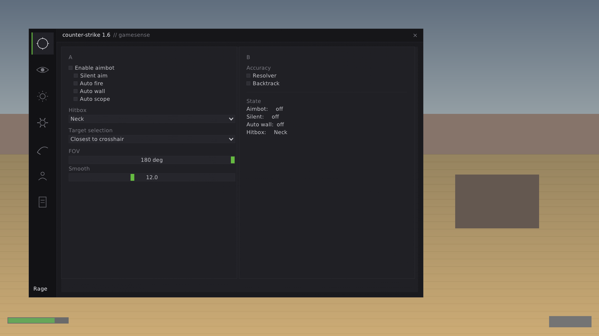
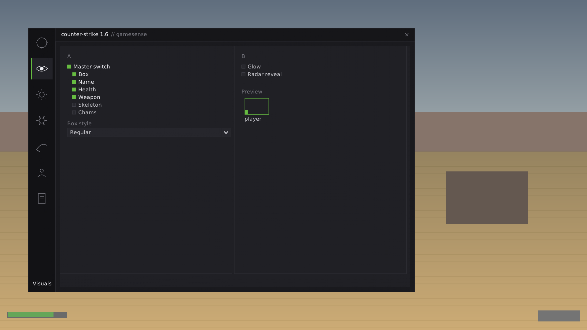
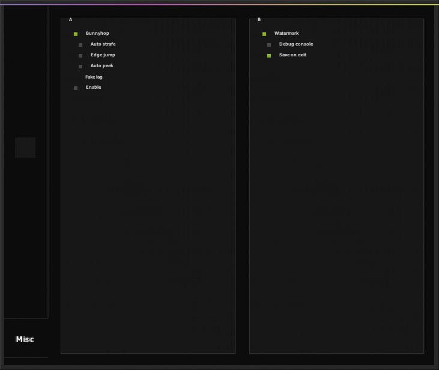
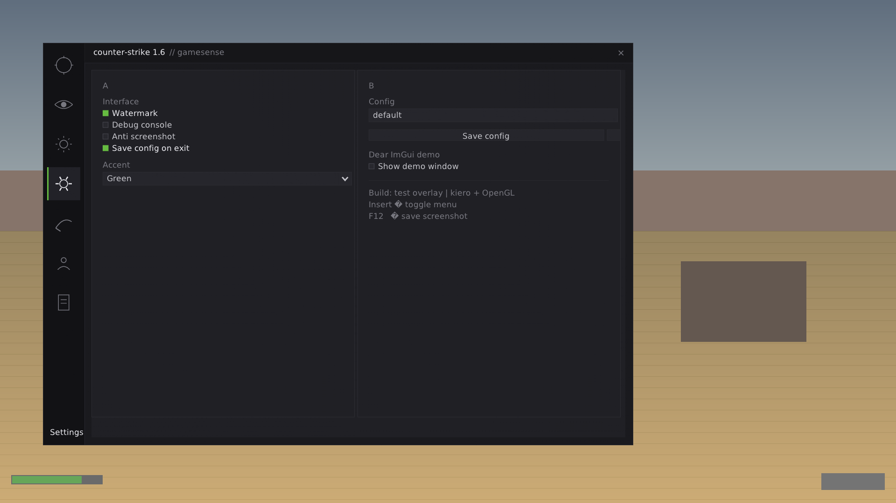
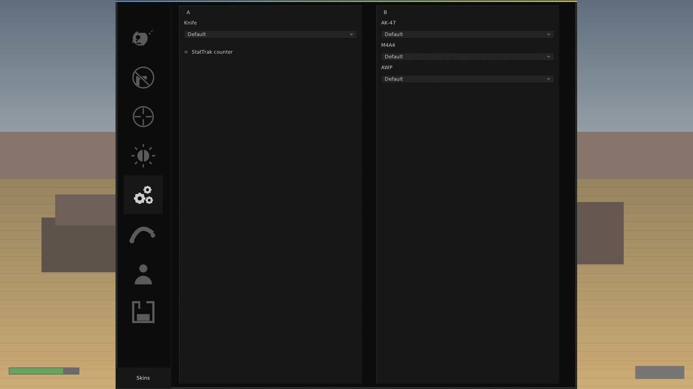

# cs1.6 — реверс и меню

Песочница для разбора Counter-Strike 1.6 и разработки меню в стиле gamesense.

## Релиз

**[v0.1-menu-test](https://github.com/QUANTUMLOADER123/cs1.6/releases/tag/v0.1-menu-test)** — тестовая 32-битная DLL меню.

- DLL: [menu_test_x86.dll](https://github.com/QUANTUMLOADER123/cs1.6/raw/arena/6f730c22-cs1-6/releases/v0.1-menu-test/menu_test_x86.dll) (1.4 МБ, PE32 i386)
- Все файлы релиза: [releases/v0.1-menu-test/](releases/v0.1-menu-test/)

`INSERT` — меню, `F12` — скриншот. Подробности — [releases/v0.1-menu-test/README.md](releases/v0.1-menu-test/README.md).

## Скриншоты меню

1920×1080, отрендерены тем же кодом, что работает в оверлее.

| Rage | Visuals |
| --- | --- |
|  |  |

| Misc | Settings |
| --- | --- |
|  |  |



Прямые ссылки (для телефона):

- [Rage](https://github.com/QUANTUMLOADER123/cs1.6/blob/arena/6f730c22-cs1-6/cs1.6/menu/shots/rage.png)
- [Visuals](https://github.com/QUANTUMLOADER123/cs1.6/blob/arena/6f730c22-cs1-6/cs1.6/menu/shots/visuals.png)
- [Misc](https://github.com/QUANTUMLOADER123/cs1.6/blob/arena/6f730c22-cs1-6/cs1.6/menu/shots/misc.png)
- [Settings](https://github.com/QUANTUMLOADER123/cs1.6/blob/arena/6f730c22-cs1-6/cs1.6/menu/shots/settings.png)
- [Skins](https://github.com/QUANTUMLOADER123/cs1.6/blob/arena/6f730c22-cs1-6/cs1.6/menu/shots/skins.png)

## Что где

```
cs1.6/menu/            меню: исходники, Makefile, build_win.sh, скриншоты
releases/              собранные версии (DLL + скриншоты + README)
cs1.6/analysis/        реверс DLL: symbols, vtables, strings, index.json
cs1.6/REVERSE.md       разбор DLL и найденные точки входа
tools/analysis/        pe_triage.py (триаж PE), r2_decompile.py (декомпиляция)
*.dll                  файлы игры: hw, client, mp, Core, DemoPlayer, client_mini, SDL2
```

## Реверс

Все 7 DLL разобраны. Ключевое: `client.dll` экспортирует все `HUD_*` и `CL_*`
функции — `HUD_Redraw`, `HUD_Frame`, `HUD_AddEntity`, `CL_CreateMove`. Это
готовые точки входа для софта.

| DLL | функций | декомпилировано |
| --- | --- | --- |
| hw.dll | 5630 | 4575 |
| mp.dll | 3656 | 3656 |
| client.dll | 3125 | 3125 |
| Core.dll | 792 | 792 |
| client_mini.dll | 753 | 753 |
| DemoPlayer.dll | 402 | 402 |

Тела функций в git не лежат (68 МБ), генерируются за минуту:

```bash
python3 tools/analysis/r2_decompile.py hw.dll -o cs1.6/analysis/hw --min-size 16
```

Подробности — [cs1.6/REVERSE.md](cs1.6/REVERSE.md).

## Сборка меню

```bash
cd cs1.6/menu
make                        # headless-рендерер (Linux, без GPU)
./menu.png out.png 2 0      # 2x скейл, вкладка Rage

./build_win.sh              # Windows DLL через zig (без MSVC)
```

Детали — [cs1.6/menu/README.md](cs1.6/menu/README.md).
