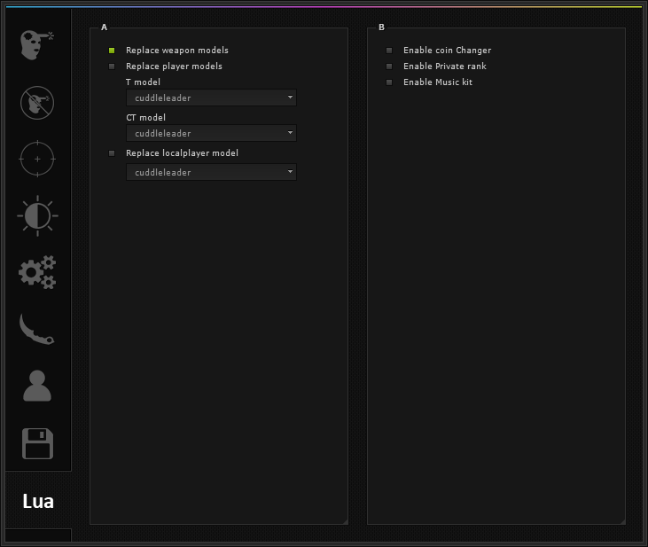

# cs1.6 — реверс и меню

Песочница для разбора Counter-Strike 1.6 и разработки меню — **порт 1:1** меню gamesense (skeet).

## Что значит «1:1»

Меню воспроизведено по реальному скриншоту gamesense 731×617 пиксель-в-пиксель:

- **иконки — настоящий спрайт** `tab_icons.png` (384×48, 8 плиток 48×48), выгруженный из
  репозитория gamesense-меню; лежит в `cs1.6/menu/assets/`, встроен в сборку как C-массив;
- **шрифт — настоящий Tahoma Bold**, тот же, что в gamesense (`cs1.6/menu/assets/Tahoma-Bold.ttf`);
- **цвета и геометрия сняты сканером** с референса: рамка `#3C3C3C`/`#282828`, тело колонок
  `#171717`, рамка колонок `#303030`, текст `#CDCDCD`, галка `#95C021`, поля — градиент
  `#1F1F1F → #242424`, шахматный дизеринг `#0C0C0C`/`#141414`, радуга 2px под рамкой;
- **8 вкладок как в gamesense**: Rage, Anti-Aim, Visuals, Misc, Settings, Skins, Players, Lua.

Проверка совпадения: средняя разница по всем 731×617 пикселям — **3.7 из 255**,
81 % пикселей отличаются не более чем на 1/255 (остальное — сглаживание глифов).

## Релиз

**[v0.1-menu-test](https://github.com/QUANTUMLOADER123/cs1.6/releases/tag/v0.1-menu-test)**

- DLL: [menu_test_x86.dll](https://github.com/QUANTUMLOADER123/cs1.6/raw/arena/6f730c22-cs1-6/releases/v0.1-menu-test/menu_test_x86.dll) (PE32 i386)
- Все файлы релиза: [releases/v0.1-menu-test/](releases/v0.1-menu-test/)

`INSERT` — меню, `F12` — скриншот.

## Скриншоты меню (1:1, 731×617)

| Rage | Anti-Aim |
| --- | --- |
|  |  |

| Visuals | Misc |
| --- | --- |
|  |  |

| Settings | Skins |
| --- | --- |
|  |  |

| Players | Lua |
| --- | --- |
|  |  |

Прямые ссылки (для телефона):

- [Rage](https://github.com/QUANTUMLOADER123/cs1.6/blob/arena/6f730c22-cs1-6/cs1.6/menu/shots/rage.png)
- [Anti-Aim](https://github.com/QUANTUMLOADER123/cs1.6/blob/arena/6f730c22-cs1-6/cs1.6/menu/shots/antiaim.png)
- [Visuals](https://github.com/QUANTUMLOADER123/cs1.6/blob/arena/6f730c22-cs1-6/cs1.6/menu/shots/visuals.png)
- [Misc](https://github.com/QUANTUMLOADER123/cs1.6/blob/arena/6f730c22-cs1-6/cs1.6/menu/shots/misc.png)
- [Settings](https://github.com/QUANTUMLOADER123/cs1.6/blob/arena/6f730c22-cs1-6/cs1.6/menu/shots/settings.png)
- [Skins](https://github.com/QUANTUMLOADER123/cs1.6/blob/arena/6f730c22-cs1-6/cs1.6/menu/shots/skins.png)
- [Players](https://github.com/QUANTUMLOADER123/cs1.6/blob/arena/6f730c22-cs1-6/cs1.6/menu/shots/players.png)
- [Lua](https://github.com/QUANTUMLOADER123/cs1.6/blob/arena/6f730c22-cs1-6/cs1.6/menu/shots/lua.png)

## Сверка с оригиналом

| | |
| --- | --- |
|  |  |

## Что где

```
cs1.6/menu/            меню: исходники, Makefile, build_win.sh, скриншоты
cs1.6/menu/assets/     НАСТОЯЩИЕ ассеты: tab_icons.png, Tahoma-Bold.ttf
cs1.6/menu/include/    палитра/геометрия (gui_theme.h), виджеты, меню, растеризатор
releases/              собранные версии (DLL + скриншоты + README)
cs1.6/analysis/        реверс DLL: symbols, vtables, strings, index.json
cs1.6/REVERSE.md       разбор DLL и найденные точки входа
tools/analysis/        pe_triage.py (триаж PE), r2_decompile.py (декомпиляция)
image-search/          референсы меню gamesense, с которых снимались метрики
*.dll                  файлы игры: hw, client, mp, Core, DemoPlayer, client_mini, SDL2
```

## Реверс

Все 7 DLL разобраны. Ключевое: `client.dll` экспортирует все `HUD_*` и `CL_*`
функции — `HUD_Redraw`, `HUD_Frame`, `HUD_AddEntity`, `CL_CreateMove`. Это
готовые точки входа для софта.

| DLL | функций | декомпилировано |
| --- | --- | --- |
| hw.dll | 5630 | 4575 |
| mp.dll | 3656 | 3656 |
| client.dll | 3125 | 3125 |
| Core.dll | 792 | 792 |
| client_mini.dll | 753 | 753 |
| DemoPlayer.dll | 402 | 402 |

Тела функций в git не лежат (68 МБ), генерируются за минуту:

```bash
python3 tools/analysis/r2_decompile.py hw.dll -o cs1.6/analysis/hw --min-size 16
```

Подробности — [cs1.6/REVERSE.md](cs1.6/REVERSE.md).

## Сборка меню

```bash
cd cs1.6/menu
make                        # headless-рендерер (Linux, без GPU)
./menu.png out.png 1 0      # 1 = нативный 1:1 (731x617), 2 = 1920x1080
./menu.png out.png 2 5      # 1920x1080, вкладка Skins

./build_win.sh              # Windows DLL через zig (без MSVC)
```

Детали — [cs1.6/menu/README.md](cs1.6/menu/README.md).
