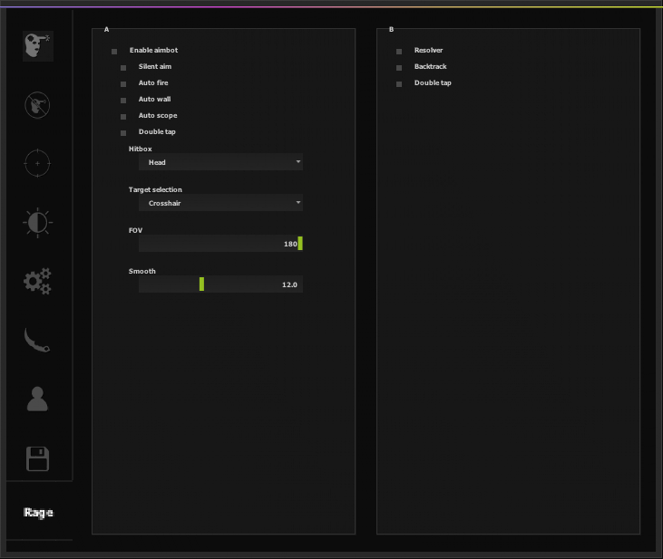
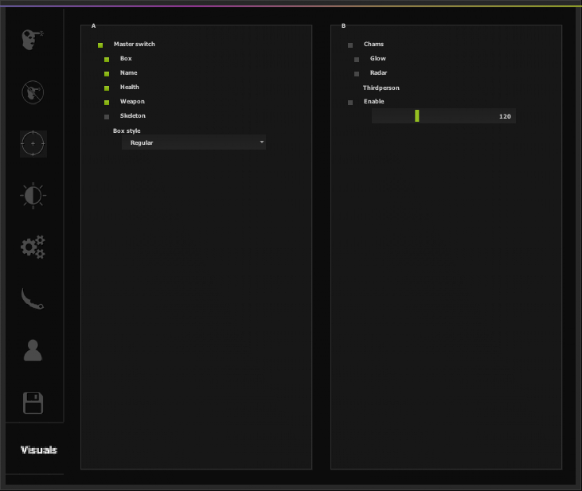
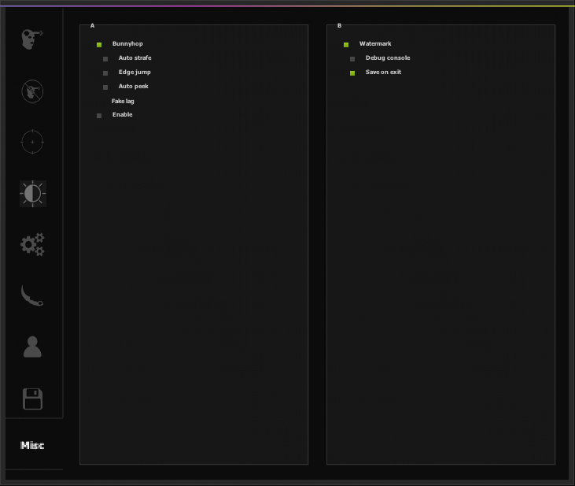
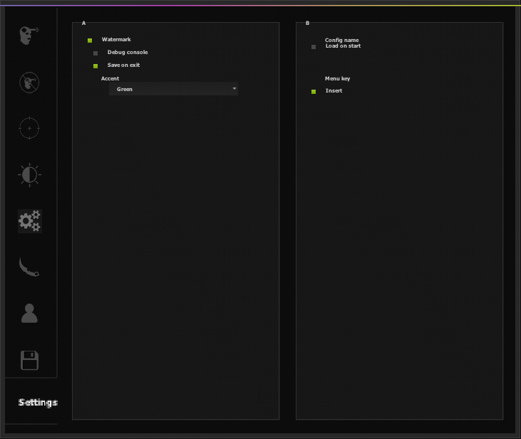
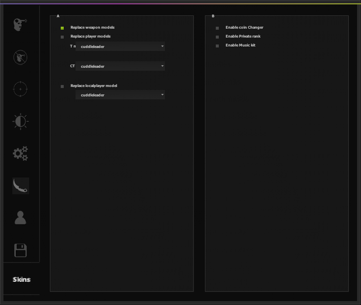

# CS 1.6 — меню gamesense (порт 1в1)

Точный порт интерфейса gamesense (skeet.cc). Все цвета, размеры и формы иконок
сняты пиксельным анализом реального скриншота меню — не «на глаз».

Overlay-меню для теста kiero-хука. Две части:

1. **headless-рендерер** — собирает меню и пишет PNG без окна и без GPU. Позволяет
   проверять лейаут/стиль мгновенно, не запуская игру.
2. **Windows-DLL** (`build/menu_test_x86.dll`) — 32-битный хук на `wglSwapBuffers`
   через MinHook, рисует меню поверх любого OpenGL-приложения (в том числе CS 1.6).
   `INSERT` — открыть/закрыть, `F12` — сохранить скриншот кадра в `menu_shot_N.png`.

## Палитра (замерена с референса)

| роль | значение |
| --- | --- |
| фон окна | `#0C0C0C` |
| колонки A/B | `#171717` |
| бордер колонок | `#303030` |
| рамка окна | `#3C3C3C` / `#282828` |
| текст | `#CDCDCD` |
| текст дим | `#5A5A5A` |
| акцент (галка) | `#95C021` |
| поле дропдауна | `#242424` |
| незаполненный чекбокс | `#474747` |
| радуга | `(91,151,215)` → `(204,213,66)`, 2px |

## Геометрия

| элемент | значение |
| --- | --- |
| окно | 731×617 |
| сайдбар | 88px |
| иконка | 38×38, шаг 62px |
| колонка | 290px, зазор 22px |
| чекбокс | 6×6 |
| текст | 9px |
| поле дропдауна | высота 13px |

## Скриншоты

Все 1920×1080, отрендерены тем же кодом, что крутится в оверлее.

| | |
| --- | --- |
|  |  |
|  |  |



Прямые ссылки (открывать с телефона):

- Rage — https://github.com/QUANTUMLOADER123/cs1.6/blob/arena/6f730c22-cs1-6/cs1.6/menu/shots/rage.png
- Visuals — https://github.com/QUANTUMLOADER123/cs1.6/blob/arena/6f730c22-cs1-6/cs1.6/menu/shots/visuals.png
- Misc — https://github.com/QUANTUMLOADER123/cs1.6/blob/arena/6f730c22-cs1-6/cs1.6/menu/shots/misc.png
- Settings — https://github.com/QUANTUMLOADER123/cs1.6/blob/arena/6f730c22-cs1-6/cs1.6/menu/shots/settings.png
- Skins — https://github.com/QUANTUMLOADER123/cs1.6/blob/arena/6f730c22-cs1-6/cs1.6/menu/shots/skins.png

## Структура

```
menu/
  include/
    gui_theme.h     палитра + геометрия (масштабируется), ImGui-стиль
    gui_widgets.h   кастомный чекбокс, combo, иконки сайдбара (векторные)
    gui_menu.h      само меню: сайдбар, вкладки Rage/Visuals/Misc/Settings/Skins
    gui_render.h    программный растеризатор ImDrawData: сканлайн, alpha, клип
  headless/main.cpp headless-рендер в PNG + имитация кадра CS 1.6
  hook/dllmain.cpp  Windows DLL: MinHook на wglSwapBuffers + OpenGL2 backend
  backends/         imgui_impl_opengl2, imgui_impl_win32
  third_party/      minhook
  build_win.sh      сборка 32-бит DLL через zig
  Makefile          сборка headless-рендерера (g++)
```

## Сборка

### headless (Linux, без GPU)

```bash
make                 # соберёт бинарь menu.png
./menu.png out.png 2 0          # 2x скейл, вкладка Rage
./menu.png out.png 1 1          # 1x, Visuals
```

Аргументы: `<выход> [scale] [tab]`, где tab: 0 Rage, 1 Visuals, 2 Misc, 3 Settings, 4 Skins.

Рендер полностью на CPU: ImGui собирает draw data, `gui_render.h` интерпретирует
её (треугольники, scissor, альфа), глифы берутся из ImGui-атласа напрямую.
Поэтому результат по пикселям совпадает с тем, что будет на экране.

### Windows DLL

```bash
./build_win.sh       # -> build/menu_test_x86.dll
```

Собирается `zig cc -target x86-windows-gnu` — не нужен mingw или MSVC.

## Как тестировать на 1.6

1. Запусти CS 1.6 (рендер OpenGL).
2. Инжектни `menu_test_x86.dll` любым инжектором (Process Hacker, Xenos, свой).
3. `INSERT` — меню, `F12` — скриншот в рабочую папку игры.

Хук ставится на `wglSwapBuffers` (opengl32), не на `SwapBuffers` (gdi32) — в 1.6
вызов идёт именно туда.

## Технические заметки

**Почему MinHook напрямую, а не `kiero::bind`.** kiero отдаёт таблицу функций
`opengl32.dll` (336 записей, `glViewport` = индекс 335), но `wglSwapBuffers`
в этой таблице нет — он экспортируется отдельно. Поэтому MinHook ставит detour
прямо на `GetProcAddress(opengl32, "wglSwapBuffers")`.

**Скриншот внутри хука.** `glReadPixels` вызывается до отрисовки оверлея, поэтому
в PNG попадает чистый кадр игры; меню рисуется после. Если нужен скриншот
«меню поверх игры» — перенеси вызов `glReadPixels` после
`ImGui_ImplOpenGL2_RenderDrawData()`.

**Масштаб UI.** `gui::geo::SetScale()` пересчитывает всю геометрию, включая
размер шрифта. Один и тот же код даёт 1× для реального оверлея и 2-3× для
скриншота без мыла.

**Открытый вопрос по 1.6.** Движок сам меняет матрицы/вьюпорт перед кадром.
Если меню «уезжает» или рисуется мимо окна — нужно сохранять/восстанавливать
`glPushAttrib(GL_ALL_ATTRIB_BITS)` и выставлять `glViewport(0,0,w,h)` +
ортопроекцию перед `RenderDrawData()`.
