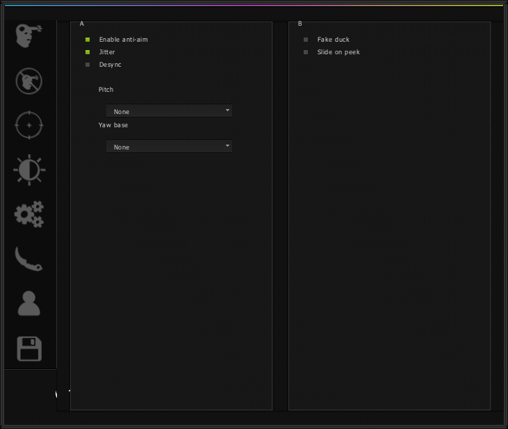
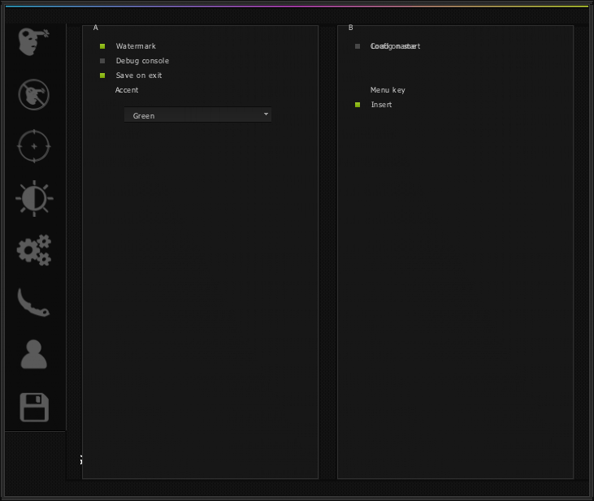
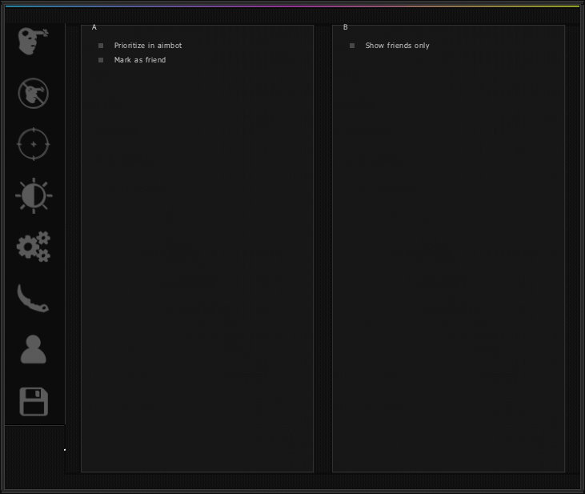
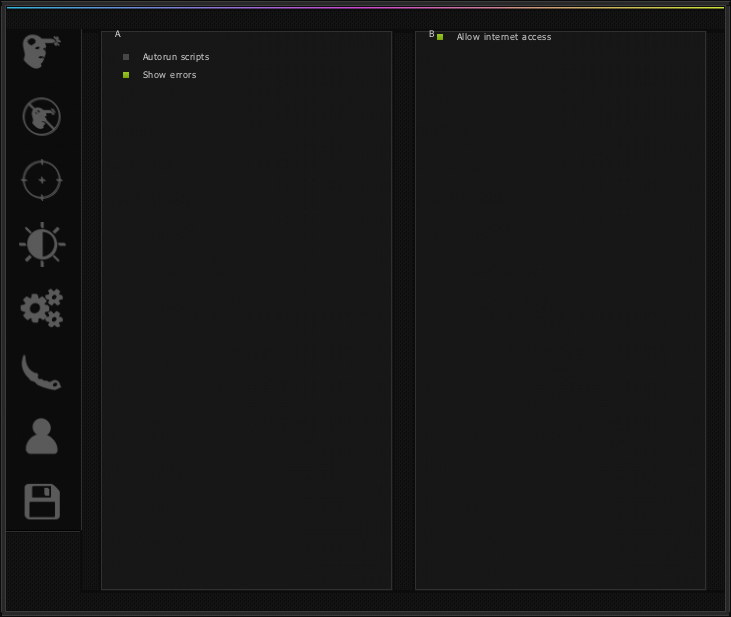

# v0.1-menu-test — меню gamesense, порт 1:1

Тестовая сборка меню для CS 1.6: **пиксельный порт меню gamesense (skeet)**
с настоящими ассетами.

## Файлы

| файл | что |
| --- | --- |
| `menu_test_x86.dll` | 32-битная Windows DLL, хук `wglSwapBuffers` + ImGui-меню |
| `rage.png`, `antiaim.png`, `visuals.png`, `misc.png`, `settings.png`, `skins.png`, `players.png`, `lua.png` | 8 вкладок, 1:1, 731×617 |
| `SHA256.txt` | контрольная сумма DLL |

SHA256: `6b8d9d8b601d6aa1369ac50475aa0e0f1b6b445d95288c23debcc0d71e4c74fe`

Скачать DLL напрямую:
https://github.com/QUANTUMLOADER123/cs1.6/raw/arena/6f730c22-cs1-6/releases/v0.1-menu-test/menu_test_x86.dll

## Что значит 1:1

Меню снято с реального скриншота gamesense попиксельно — не «в стиле», а точно:

- **иконки — настоящий спрайт** `tab_icons.png` (384×48, 8 плиток 48×48) из
  gamesense-меню, вшит в DLL (`gui_icons_data.h`, генерируется `tools/embed_assets.py`).
  Спрайт — чёрная маска (RGB≈0, информация только в альфе), поэтому при загрузке
  RGB заменяется на белый, а цвет задаётся тонированием. Размер 46px, вертикальный
  сжим 0.945, центры 43.2 / 52.7+64.08i — подобрано по ink-bbox всех 8 иконок
  референса. Порядок плиток в меню: 0, 6, 1, 2, 3, 5, 4, 7;
- **шрифт — настоящий Tahoma** (`assets/Tahoma.ttf`), вшит в DLL
  (`gui_font_data.h`), с кириллицей. Кегль текста 11px + ручной трекинг 0.5px
  (в ImGui 1.93 `GlyphExtraSpacing` удалён, поэтому `DrawTextSpaced()` рисует
  по глифу за раз и сам выставляет межбуквенный интервал — без него буквы
  слипаются, т.к. глифы пакуются вплотную). Подпись вкладки внизу сайдбара —
  отдельный бейк 24px;
- **цвета**: фон `#0C0C0C`, дизеринг `#141414`, колонки `#171717` + рамка `#303030`,
  окно `#3C3C3C`/`#282828`, текст `#CDCDCD`, галка `#9CC728`→`#7AA506`,
  поле — ступенчатый градиент `#1F1F1F`→`#242424` (значения 31,31,32,32,32,33,
  33,33,34,34,34,34,35,35,35,36,36 по 1px, бордер `#0C0C0C`), иконки `#5A5A5A`,
  дизеринг `#0C0C0C`/`#141414` — шахматка с периодом 4 по X и 4 по Y,
  радуга 2px под рамкой — кусочно-линейная по каналам на трёх участках;
- **геометрия**: окно 731×617, сайдбар 97px, колонки x 101..392 и 415..705,
  чекбокс 6×6 на x 123, текст на x 143, поля x 153..333, шаг строк 18px;
- **8 вкладок как в оригинале**: Rage, Anti-Aim, Visuals, Misc, Settings, Skins,
  Players, Lua.

Контроль качества: средняя разница с оригиналом по всем 731×617 пикселям —
**1.76 из 255**; **94.2 %** пикселей отличаются не более чем на 1/255.
Совпадают 1:1: рамка окна (все 4 стороны, включая #3C3C3C поверх #282828),
шапка, радуга (кусочно-линейная по каналам), дизеринг-шахматка (паттерн
с периодом 4×4 снят по 2D-карте), все три дропдауна, размер и положение
всех 8 иконок сайдбара, подпись вкладки. Проверяется `tools/compare_reference.py`.

## Что внутри DLL

- PE32, i386 — **32-битная**, как сам CS 1.6
- MinHook на `wglSwapBuffers` (opengl32)
- ImGui 1.93, бэкенд OpenGL2 (legacy pipeline — совпадает с рендером 1.6)
- Оригинальный спрайт иконок загружается в GL-текстуру при старте
- Tahoma Bold из памяти — не зависит от системных шрифтов

## Управление

| клавиша | действие |
| --- | --- |
| `INSERT` | открыть / закрыть меню |
| `F12` | сохранить скриншот кадра в `menu_shot_N.png` |

## Установка

Нужен инжектор (Process Hacker, Xenos, свой). DLL 32-битная — инжектить
только в 32-битный процесс.

1. Запусти CS 1.6 с рендером OpenGL.
2. Инжектни `menu_test_x86.dll` в `hl.exe`.
3. `INSERT` — меню.

## Скриншоты (1:1, 731×617)

| Rage | Anti-Aim |
| --- | --- |
|  |  |

| Visuals | Misc |
| --- | --- |
|  |  |

| Settings | Skins |
| --- | --- |
|  |  |

| Players | Lua |
| --- | --- |
|  |  |

## Ограничения

- Это **только UI и хук**. Чекбоксы запоминают состояние, но к игре не
  подключены — функционал софта будет в следующих версиях (по плану: меню
  и инфраструктура → софт → релизный билд чита).
- В 1.6 движок меняет матрицы перед своим кадром. Если меню «уедет» — нужен
  `glPushAttrib(GL_ALL_ATTRIB_BITS)` + `glViewport(0,0,w,h)` перед
  `RenderDrawData()` (в этой сборке меню рисуется уже после сброса состояния).

## Как собрано

`zig cc -target x86-windows-gnu`, без MSVC и mingw: `cs1.6/menu/build_win.sh`.
Исходники: `cs1.6/menu/` (`include/gui_*.h`, `hook/dllmain.cpp`).
