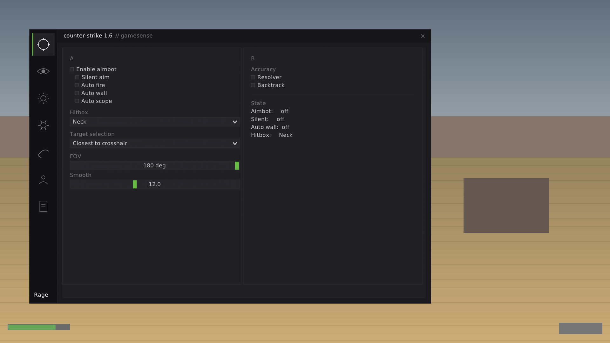
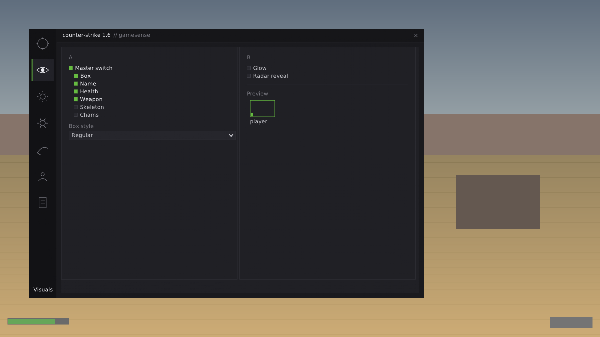
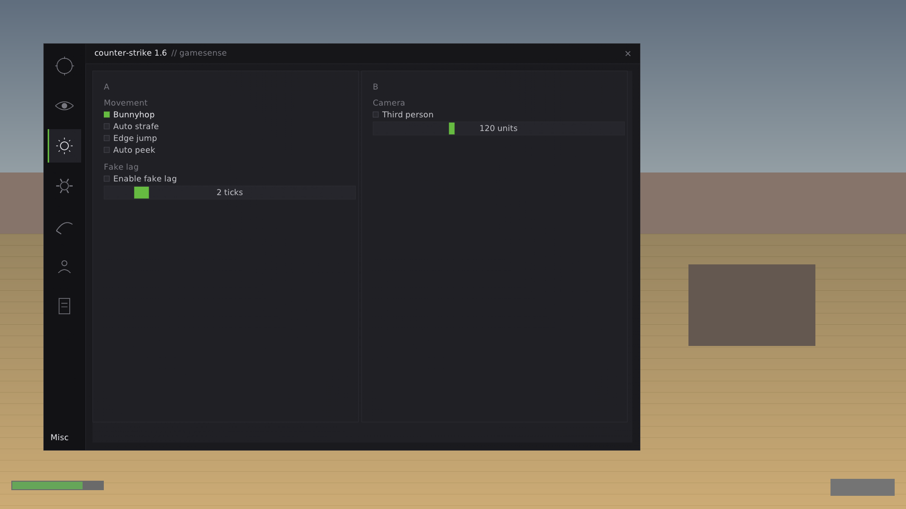
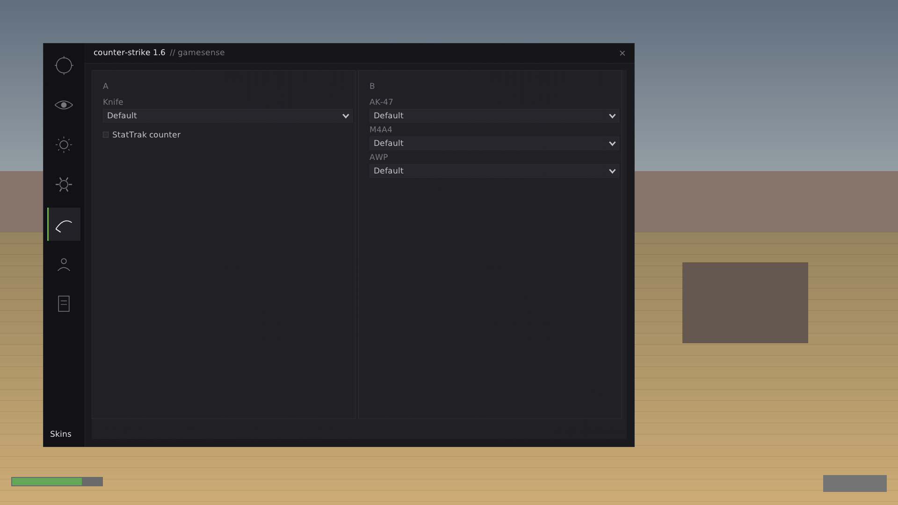

# v0.1-menu-test

Тестовая сборка меню CS 1.6 в стиле gamesense.

## Файлы

| файл | что |
| --- | --- |
| `menu_test_x86.dll` | 32-битная Windows DLL, хук `wglSwapBuffers` + ImGui-меню |
| `rage.png` … `skins.png` | скриншоты всех пяти вкладок (1920×1080) |
| `SHA256.txt` | контрольная сумма DLL |

SHA256: `9204cba34ee1ffecadb27b0684b696d2fa4cc6e82bf3ed33ea8da18255d0c63b`

Скачать DLL напрямую:
https://github.com/QUANTUMLOADER123/cs1.6/raw/arena/6f730c22-cs1-6/releases/v0.1-menu-test/menu_test_x86.dll

## Что внутри

- PE32, i386 — **32-битная**, как сам CS 1.6
- MinHook на `wglSwapBuffers` (opengl32)
- ImGui, бэкенд OpenGL2 (legacy pipeline — совпадает с рендером 1.6)
- Меню: сайдбар с 7 иконками, колонки A/B, 5 вкладок
- Шрифт Tahoma с кириллицей (системный)

## Управление

| клавиша | действие |
| --- | --- |
| `INSERT` | открыть / закрыть меню |
| `F12` | сохранить скриншот кадра в `menu_shot_N.png` |

## Установка

Нужен инжектор (Process Hacker, Xenos, свой). DLL 32-битная — инжектить
только в 32-битный процесс.

1. Запусти CS 1.6 с рендером OpenGL.
2. Инжектни `menu_test_x86.dll` в `hl.exe`.
3. `INSERT` — меню.

## Скриншоты

| | |
| --- | --- |
|  |  |
|  |  |

## Ограничения

- Это **только UI и хук**. Aimbot/ESP-чекбоксы запоминают состояние, но к игре
  не подключены — функционал софта будет в следующих версиях.
- В 1.6 движок меняет матрицы перед своим кадром. Если меню «уедет» или
  окажется не на месте — нужно добавить `glPushAttrib(GL_ALL_ATTRIB_BITS)` +
  `glViewport(0,0,w,h)` и ортопроекцию перед `RenderDrawData()`.

## Как это собрано

`zig cc -target x86-windows-gnu`, без MSVC и mingw. Скрипт в репо:
`cs1.6/menu/build_win.sh`.

Исходники меню: `cs1.6/menu/` — `include/gui_*.h` + `hook/dllmain.cpp`.
